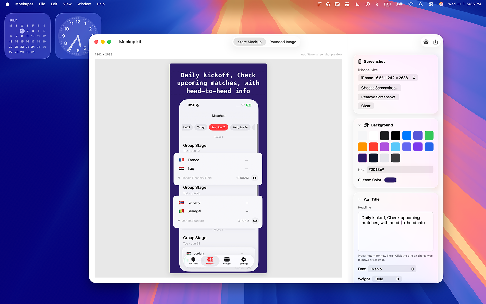
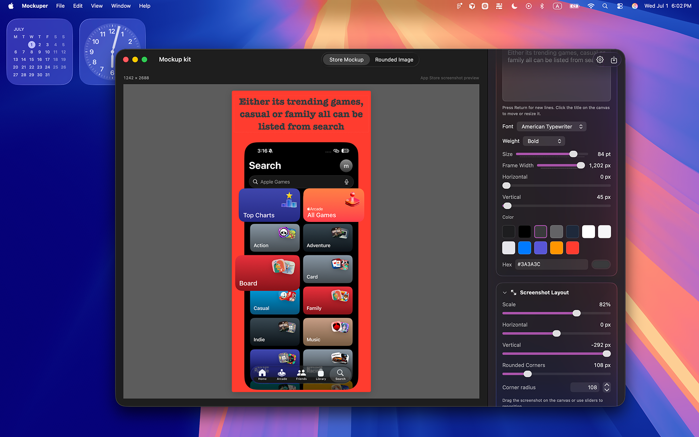

Screenshot updates are easier to repeat when the capture, copy, composition, and upload checks have a clear order. This workflow is for indie developers creating iPhone listing artwork on a Mac with Mockup Kit. For a Mac app's own listing, check Apple's Mac screenshot sizes separately.

The goal is a clear, accurate release story. This is a working checklist, not a promise of a particular conversion rate or review outcome.

## Plan one task per frame

Choose the user tasks that changed in the release. For a habit app, a small story could show setting a goal, recording today's progress, and reviewing a streak. Write one headline for each capture before adding decorative elements.

Capture the build whose UI users will receive. Use sample data and remove private information. Keep originals in a release folder so you can revise crops without recapturing everything.

## Compose the first frame before repeating it

1. Import the strongest capture into Store Mockup.
2. Select the listing canvas you need and choose a background.
3. Write a short, specific headline and adjust the type size and color.
4. Position the device and headline so important UI remains visible.
5. Add a badge or image overlay only when it explains a real capability.

Once this frame reads clearly at a small size, reuse its color and typography choices for the rest of the set. Arrange up to ten boards in the screenshot workspace. See the [background recipes](/blog/best-app-store-screenshot-backgrounds-and-gradients/) for hex values you can keep with your notes.

## Choose exports from the listing requirements

Do not treat every canvas preset as a mandatory upload. Use [Apple's current screenshot specifications](https://developer.apple.com/help/app-store-connect/reference/app-information/screenshot-specifications) to identify the device families and accepted dimensions for your app.

Mockup Kit's portrait presets include 1242 × 2688, 1320 × 2868, 1284 × 2778, 1290 × 2796, 1179 × 2556, and 1170 × 2532 pixels. Check the selected dimensions before export, then inspect the actual file. A dimension check cannot tell whether a headline is misleading or a capture hides an important control.

Use clear filenames and folders outside the editor. For example, a manually organized release folder could contain `en-US/01-overview-1320x2868.png` and `en-US/02-progress-1320x2868.png`. These are suggested filenames for a manually organized folder. Screenshot Export All produces JPEG files in language folders; its generated names include the board name, sequence, language, and pixel dimensions, such as `overview-01-en-1320x2868.jpg` for an Overview board.

## Prepare localization as content work

Keep the source headline and translation together. Check meaning, line breaks, and words embedded inside screenshots. A longer translation may need a different line break or image placement; right-to-left languages also need an appropriate visual check.

The available screenshot workspace keeps per-language headlines and images, offers right-to-left and expanded-layout previews, and exports completed localizations into language folders. These layout previews help find collisions, but they do not replace a language review. Version 2.6.0 extends this workflow to the new Header/Search creative scenes; that update has been submitted for review and is not yet publicly available.

## Plan optional creative artwork separately

Version 2.6.0 also adds Header, Search Results, and Universal scenes with six editable category templates, image and text layers, cards, badges, rings, and undo/redo. Store Preview provides illustrative app search and product page layouts; it is not a live Apple listing or an approval check.

Apple makes these placements optional for iOS and iPadOS apps and games running iOS 27 or iPadOS 27 or later. They do not apply to a macOS app's listing. See [Apple's placement guidance](https://developer.apple.com/help/app-store-connect/manage-app-information/manage-your-app-store-assets).

Keep the key artwork inside the studio's art-safe guides and verify the final crop. Header uses 3840 × 1646 PNG; Search Results supports 1920 × 1280 through 3840 × 2560 at 3:2 in PNG or JPEG; Universal uses 5244 × 2950 PNG. Opaque RGB export removes transparency. Always recheck [Apple's creative specifications](https://developer.apple.com/help/app-store-connect/reference/app-information/creative-assets-specifications) before uploading.

## Use Rounded Image for a standalone asset

Rounded Image applies corner radius in pixels or a percentage and exports PNG. Use it for a press-kit image, website illustration, or another single-image finishing task. It is a different workflow from composing a full screenshot mockup or an upcoming Header/Search creative scene.

## Run a release checklist

- Captures and claims match the release build.
- Headlines stay readable at small display sizes.
- Each frame communicates a different useful task.
- Translations and screenshot text have been checked.
- Dimensions and file formats match the intended placement.
- Exported files open correctly, and opaque creative assets have no alpha channel.
- The uploaded assets look right in App Store Connect's own preview.
- Source captures, copy, and final exports are saved outside the app session.

Screenshot preflight already flags missing or unreadable images, missing translations, overflowing text, clipped overlays, and filename conflicts. Screenshot Export All shows progress, supports cancellation, and retries unfinished items without replacing successful files; its output is opaque JPEG. The upcoming creative studio also checks its placement-specific dimensions and formats. These checks help preparation; Apple still evaluates the actual submission.

## Finish before quitting

Mockup Kit projects stay in memory during the current app session. Saving and reopening project files is not yet available. Export your finished work and retain your captures and copy before closing the app.

One successful selected screenshot or creative export is free. Premium unlocks unlimited selected exports and Export All. Eligible monthly subscribers may see a three-day introductory trial; local pricing and terms are shown in the purchase sheet. For the basic composition steps, return to [making App Store screenshots on Mac](/blog/how-to-make-app-store-screenshots-on-mac/).
