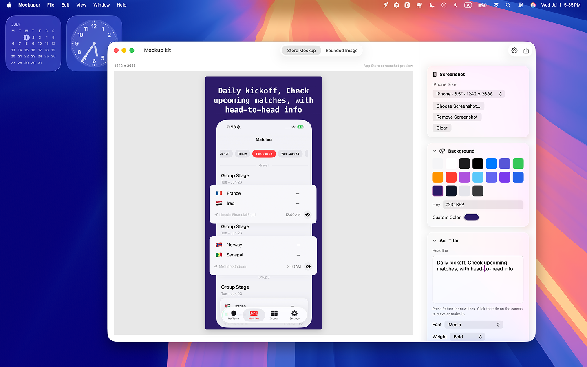
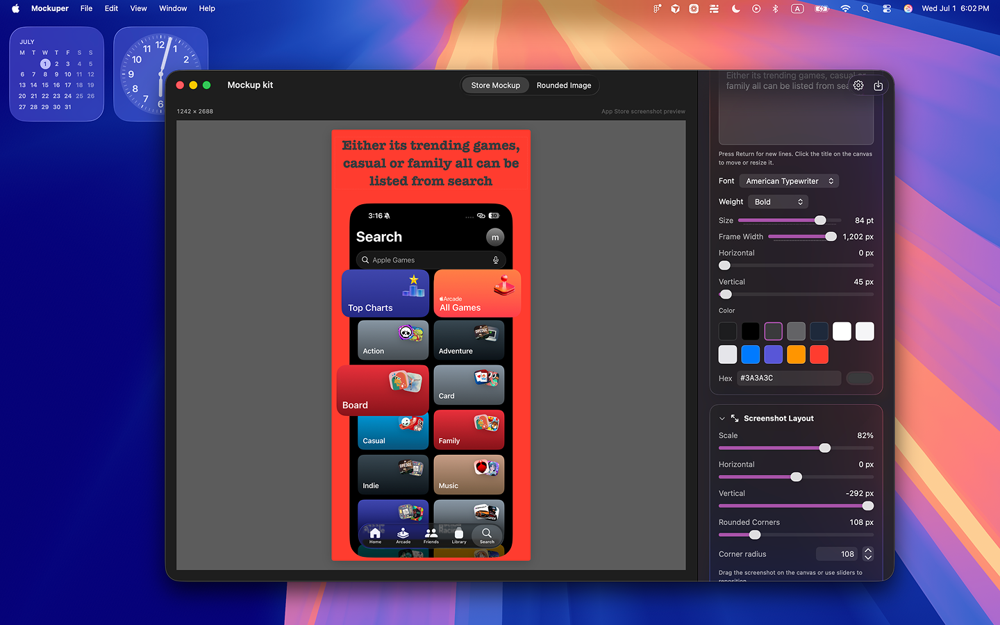

A screenshot background should help people distinguish the app UI, headline, and surrounding artwork. A solid color is a useful starting point for a busy interface; a restrained gradient can add depth behind a simpler capture. Neither choice is a universal conversion winner.

This guide provides color recipes you can enter into Mockup Kit and a contrast check you can repeat across a screenshot set. For the complete import-to-export sequence, start with [making App Store screenshots on Mac](/blog/how-to-make-app-store-screenshots-on-mac/).

## Choose a background for the capture

Begin with the most important screen, not an empty canvas. A dense finance dashboard may benefit from a plain navy field and a short light headline. A fitness activity card might work with a teal gradient and enough space around its numbers. Treat these as design directions to test with your own UI, not category rules.

Try a solid when your capture contains charts, photographs, or many small controls. Try a two-color gradient when the capture is visually simple. Keep the headline away from the gradient's lowest-contrast region.

## Solid color recipes

Use these hex values in Mockup Kit's color controls, then check the result against your own capture. The names describe the recipes; they do not imply performance results or Apple endorsement.

```swatches
Indigo Blue | #2563EB
Deep Navy | #1E3A8A
Soft Purple | #9E52F5
Violet | #7C3AED
Charcoal Navy | #1A1F36
Midnight | #0F172A
Warm Cream | #F5F0E8
Soft Sand | #E8DCC8
```

For light UI, begin by testing a darker field or adding enough separation around the device frame. For dark UI, test a lighter field or a visible edge. White and black can both be intentional brand choices; inspect whether the app's outline and headline remain clear rather than rejecting those colors automatically.

## Two-color gradient recipes

Choose custom start and end colors. Keep the transition away from small text when possible, and inspect the whole image rather than each swatch in isolation.

```swatches
Productivity Blue | #3B82F6 -> #1D4ED8
Modern Purple | #A855F7 -> #6366F1
Sunset Warmth | #F97316 -> #EC4899
Dark Premium | #1E293B -> #0F172A
Fresh Teal | #2DD4BF -> #0891B2
Soft Dawn | #FFF7ED -> #FDE68A
Health Green | #34D399 -> #059669
Indigo Glow | #818CF8 -> #4F46E5
```

A warm orange-to-pink field is useful to try with a simple lifestyle capture, but it may clash with a similarly colored interface. Move to a neutral field if your artwork and UI compete for attention. A design is ready when its content is understandable, not when it matches a supposed category trend.

## Apply the recipe in Mockup Kit

1. Import the screenshot and select the export canvas.
2. Set a background preset or enter your custom colors.
3. Add the headline with a readable size and a contrasting text color.
4. Position the device and any overlay so the background remains supporting artwork.
5. Export a test and inspect it at full size and at a small browsing size.



Do not use an export preview as evidence that a design improves conversion. If you evaluate variants with a store experiment, keep the capture and message consistent so the background is the meaningful change.

## Check contrast across the set

- Can you identify the app UI without first reading the headline?
- Is the headline readable on the lightest and darkest area behind it?
- Do badges obscure controls or repeat the headline?
- Does the device frame separate cleanly from the background?
- Does each frame use the same basic color and typography system?



For localized copy, reserve space for longer translations rather than shrinking each language to fit a tight English composition. Screenshot workspaces already support per-language headlines and images, with right-to-left and expanded test layouts. The upcoming Mockup Kit 2.6.0 studio extends localization to Header/Search creative scenes and adds style syncing from a screenshot board; public availability for that update has not yet been confirmed.

## Keep placement rules separate from color choices

App screenshots must depict the app experience and meet the dimensions for the supported device families. Check [Apple's screenshot specifications](https://developer.apple.com/help/app-store-connect/reference/app-information/screenshot-specifications) for your listing.

Optional Header and Search Results creatives have separate rules and are currently for iOS/iPadOS 27+ placements, not macOS listings. See [Apple's asset guidance](https://developer.apple.com/help/app-store-connect/manage-app-information/manage-your-app-store-assets). Their exported images cannot contain transparency; Header and Universal require PNG, while Search Results accepts PNG or JPEG under the current [creative specifications](https://developer.apple.com/help/app-store-connect/reference/app-information/creative-assets-specifications).

## Keep a reusable recipe outside the session

Write down the background hex values, headline font and size, and chosen canvas. Save source captures and final exports together. Mockup Kit projects are currently session-only, so this small recipe helps you rebuild a composition after closing the app. Use the [indie screenshot workflow](/blog/app-store-screenshot-workflow-for-indie-developers/) to organize those release materials.
