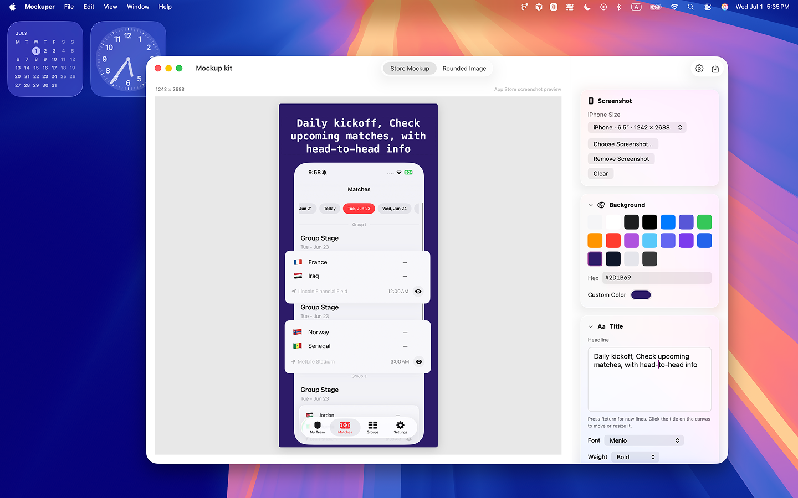

Create two adjacent App Store screenshot boards from the same sample item. Capture it immediately before one action in your app and again after the action finishes. Use the same canvas, device placement and visual treatment on both boards so readers can see what changed.

## Capture both states from one run

Choose an action with a visible result. Use publishable sample data and keep the device, app appearance and sample item the same. Match the view or zoom where the app allows it. If the action opens a different view, leave a shared detail visible on both screens, such as the same file name.

Imagine a document scanner with a straighten control. Photograph one page of sample meeting notes. Capture the skewed page in the editor, then straighten that same scan and capture the corrected view. Keep the page title visible in both captures so readers can recognize the document. Show the crop and perspective the app actually produces.

## Compose two neighboring boards

1. Open Store Mockup on your Mac, import the before capture and choose a portrait canvas that fits your target listing. Import the after capture on the next board and use the same canvas preset. Check the accepted dimensions for your target devices. [Apple's screenshot specifications](https://developer.apple.com/help/app-store-connect/reference/app-information/screenshot-specifications)
2. Match the background, device size and device position across the boards. In the scanner example, leave the page corners visible on both boards so the change in angle is visible inside the mockup.
3. Write a headline for each board that makes sense on its own. For the scanner, try “Capture at an angle” and “Straighten the scan.” Keep the before board immediately ahead of the after board. For the initial canvas and device setup, follow the [Mac screenshot guide](/blog/how-to-make-app-store-screenshots-on-mac/).

## Check that the change is visible

View the boards side by side at the same small size. Cover the headlines for one pass. In the scanner example, look for the same page title and check whether you can see the page edges straighten. If the change disappears, use a sample with clearer page edges and recapture both states. If the page appears to jump, check that the device size and position match before revisiting the app captures.

Uncover the headlines and look at each board on its own. Check that the text describes the screen and leaves the relevant detail visible. Export both boards, reopen the files and review them in the intended order.

Mockup Kit exports a selected screenshot as PNG or JPEG. One selected screenshot or creative export is free, and Premium unlocks unlimited selected exports and Export All. The editor keeps projects for the current session, so keep the original captures and both finished files outside the app before quitting.
