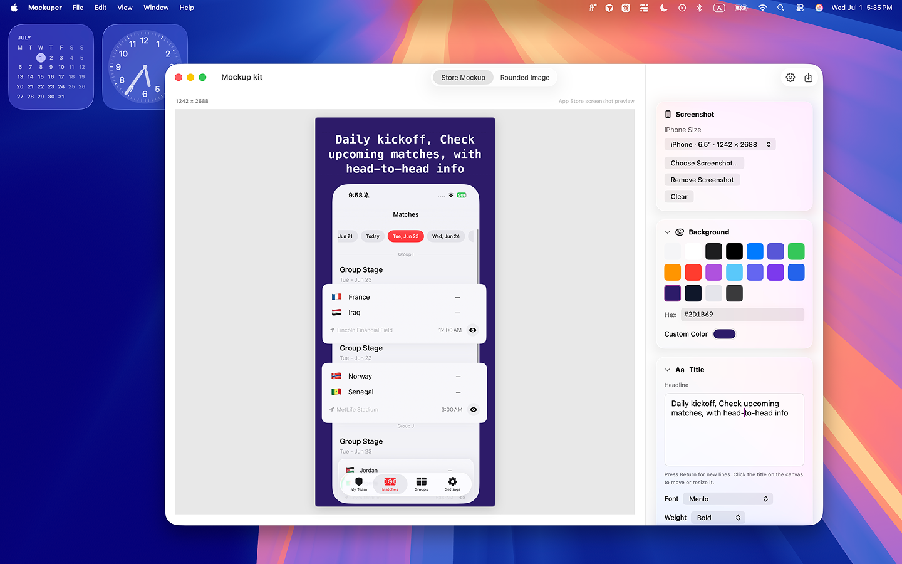
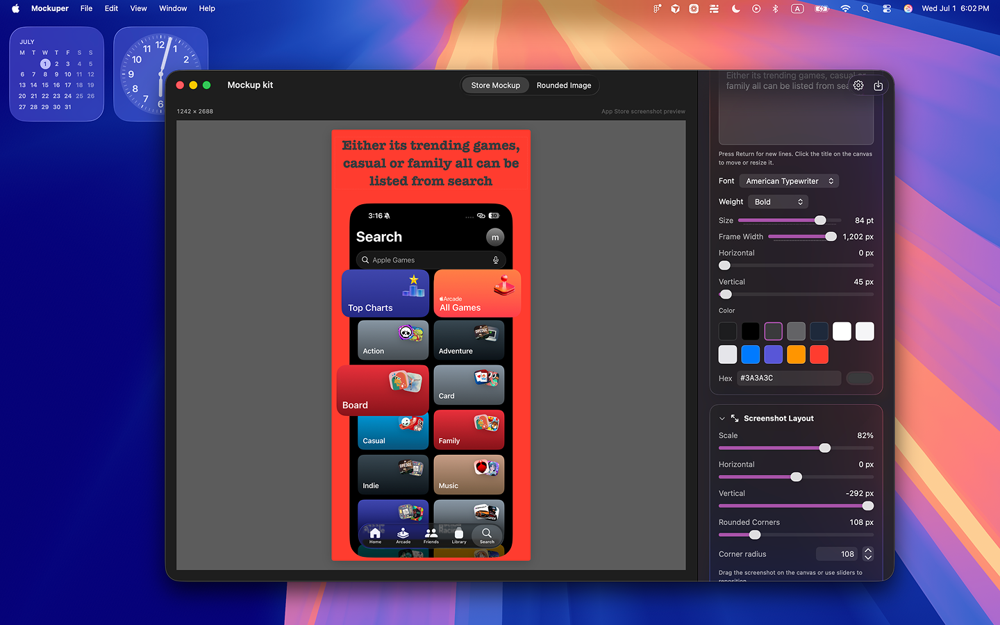

To make iPhone App Store screenshots on a Mac, import a clean app capture, choose the listing canvas, add a readable headline and background, then export and inspect the file. Mockup Kit handles that composition in a native macOS workspace.

## Choose the canvas before composing

Use [Apple's screenshot specifications](https://developer.apple.com/help/app-store-connect/reference/app-information/screenshot-specifications) to check your supported devices and accepted dimensions. Export the sizes your listing needs, rather than every preset.

Mockup Kit includes these portrait canvases:

| Width | Height |
| --- | --- |
| 1242 px | 2688 px |
| 1320 px | 2868 px |
| 1284 px | 2778 px |
| 1290 px | 2796 px |
| 1179 px | 2556 px |
| 1170 px | 2532 px |

This is the tool's preset list, not every size Apple accepts. For a macOS app's own listing, check Apple's Mac requirements: designing on a Mac does not make an iPhone canvas suitable for a Mac listing.

## Capture a real product story

Choose screens that explain a task. A budgeting-app example could show adding an expense, viewing category spending, and checking a monthly total. Use publishable sample data and remove private information.

Give each capture one specific message. “Know where it went” could explain a spending chart; it is a copy example, not a conversion claim.

## Compose the screenshot on your Mac

1. Import the capture into Store Mockup and select the required canvas.
2. Choose a solid background or gradient that separates the UI from the canvas.
3. Add a short headline; adjust its font, weight, color, and wrapping.
4. Position the device and headline without hiding important controls.
5. Add an image overlay only when it explains a real capability. An “Offline Mode” badge belongs on an app that actually works offline.

Inspect the composition at a small browsing size. Shorten an unreadable headline before shrinking its type. Try the [background recipes](/blog/best-app-store-screenshot-backgrounds-and-gradients/) for starting colors.

## Build and localize the whole screenshot set

Version 2.5.8 already supports up to ten boards, language-specific headlines and screenshots, and right-to-left or expanded test layouts. Reuse the first board's margins, colors, and typography while changing each capture and message.

Leave room for longer translations. Check words embedded inside screenshots as well as editable headlines; a layout preview does not replace language review.

## Export and inspect the file

Selected screenshot export supports PNG or JPEG. Premium Export All produces opaque JPEG files in language folders with consistent filenames, progress, cancellation, and retry of unfinished items.

Screenshot preflight checks missing or unreadable images, missing translations, headline overflow, clipped overlays, and filename conflicts. Reopen the output to check dimensions, crop, text, and image quality, then inspect the upload in App Store Connect. Preflight does not guarantee Apple approval.

## Keep optional creative assets separate

The upcoming 2.6.0 release adds the Headers & Search Results studio, category templates, layered scenes, illustrative store previews, style syncing, and creative-scene localization/export. Public release is not yet confirmed.

Apple's optional Header/Search placements serve iOS/iPadOS 27+ apps and games, not macOS listings. Check [asset eligibility](https://developer.apple.com/help/app-store-connect/manage-app-information/manage-your-app-store-assets) and the separate [creative specifications](https://developer.apple.com/help/app-store-connect/reference/app-information/creative-assets-specifications).

## Before closing the editor

Keep source captures and copy outside the app, reopen your exported files, and retain the finished set. Projects remain in memory during the current session; saving and reopening project files is not yet available. Use the [indie release checklist](/blog/app-store-screenshot-workflow-for-indie-developers/) for the final upload checks.
